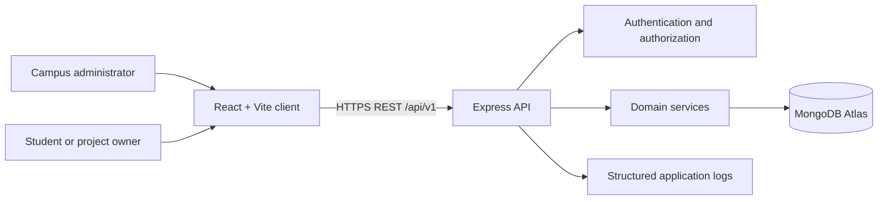
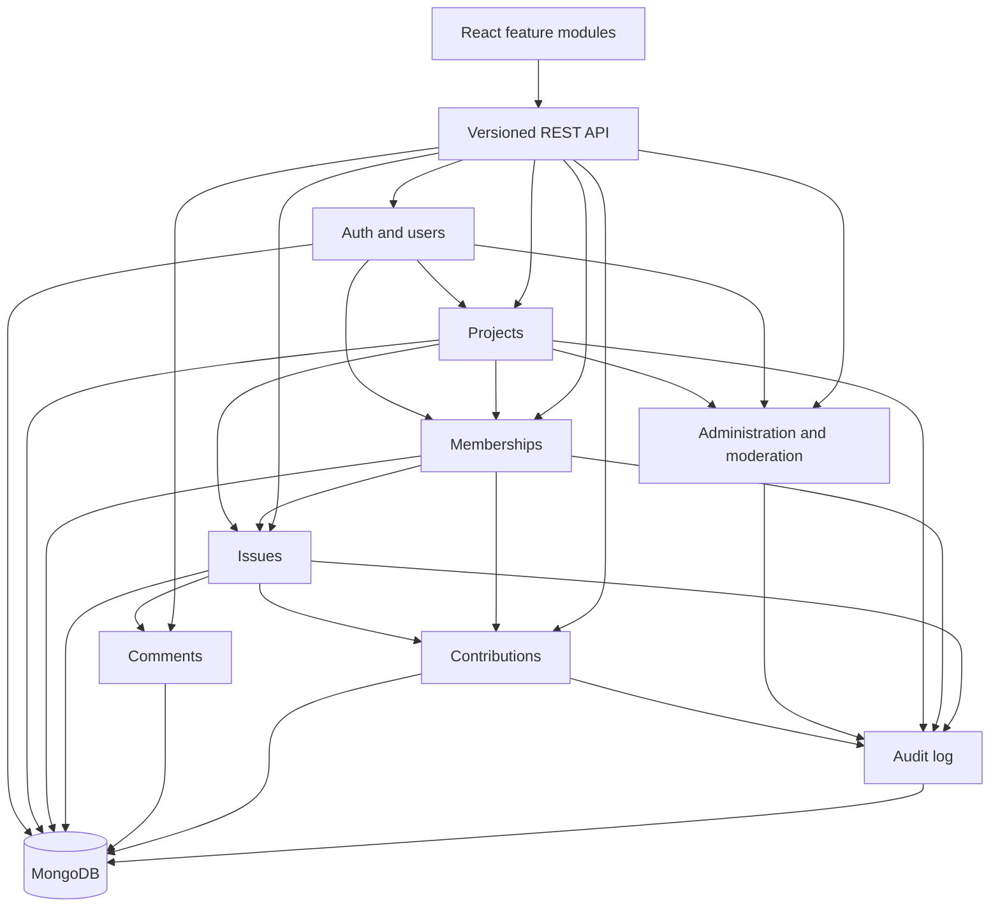

# System Architecture

## 1. Architecture Overview

Use a small, single-repository MERN application with a React/Vite browser client, an Express REST API, and MongoDB Atlas. Keep the API stateless and organized as a modular monolith: one deployable backend with explicit domain modules. This is straightforward for one developer to build and operate, while preserving clear boundaries if the product grows.



The browser never connects directly to MongoDB. The API owns validation, business rules, permissions, persistence, and response shaping. There are no microservices, message queues, or AI services in the MVP.

## 2. Deployment Topology

- Frontend: build static Vite assets and serve through a CDN/static host.
- Backend: deploy the Node.js/Express API to a managed Node hosting service. Keep at least one production instance and expose health/readiness endpoints.
- Database: MongoDB Atlas, separate development/test/production databases or clusters as appropriate, with production network access restricted to the API host where feasible.
- Preferred browser/API origin: serve the API behind the frontend site's `/api` path using hosting rewrites or a reverse proxy. This simplifies secure cookie behavior. If deployed on separate sites, explicitly configure exact CORS origins, secure `SameSite=None` cookies, and CSRF protection.
- All external traffic uses TLS. Secrets are supplied by the deployment secret manager, never committed to Git or bundled into Vite variables.
- Backups: enable managed backups appropriate to the selected Atlas tier and document restore steps before launch.

## 3. Frontend Architecture

### Application layers

- `app`: router setup, application providers, route guards, and global error boundary.
- `features`: domain-oriented screens and components for auth, profile, projects, memberships, issues, contributions, and administration.
- `components`: shared, domain-neutral controls, layout, form fields, status indicators, and accessible feedback.
- `services`: Axios instance and API functions grouped by domain. Keep HTTP details out of presentational components.
- `context`: authentication/session context only where shared state is needed. Avoid duplicating server state in Context.
- `utils`: formatting and small pure helpers.

Use React Router for route composition and protected route presentation. Route guards are a UX convenience only; API authorization remains authoritative. Use Axios with a single configured instance, a stable API base path, credentials enabled for cookie authentication, and a response interceptor only for common handling (not permission logic). Forms should have client-side usability checks while the API repeats all validation. Screens need loading, empty, success, and error states.

### Suggested routes

- `/` and `/projects`: approved project discovery.
- `/projects/:projectId`: project details, issues, and membership actions.
- `/projects/new`, `/projects/:projectId/manage`: project owner workflows.
- `/issues/:issueId`: issue details, discussion, and contribution submission.
- `/users/:userId`: public profile and verified history.
- `/profile`: own account settings.
- `/login`, `/register`: authentication.
- `/admin`: protected moderation dashboard.

## 4. Backend Architecture

Organize the Express server into layers:

1. Routes define HTTP method/path and middleware composition.
2. Middleware handles authentication, authorization helpers, request validation, rate limiting, and error translation.
3. Controllers translate HTTP requests to service calls and shape status codes/responses.
4. Services enforce domain rules and coordinate changes.
5. Models define Mongoose schemas, indexes, and persistence constraints.
6. Shared configuration and utilities handle environment validation, logging, and database connection.

Suggested domain modules: `auth`, `users`, `projects`, `memberships`, `issues`, `comments`, `contributions`, `admin`, and `audit`. Keep controllers thin. Services should receive the authenticated user identity rather than trusting identity or role fields in request bodies. Use a central error handler and a not-found handler.

### Domain rules that belong in services

- Project discovery only returns approved, non-archived projects.
- Only project owners or admins may moderate project membership, issues, and contribution reviews.
- Only members may create issues or contribute under the selected MVP policy.
- A project owner cannot approve their own project unless policy explicitly adds an audited admin exception.
- A contribution author cannot verify their own submission.
- Status changes must follow explicit transition rules.
- Multi-document changes (such as accepting a membership request and establishing membership) should use a MongoDB transaction when deployed on a replica set; otherwise design an idempotent update and reconciliation rule.

## 5. Database Architecture

Use Mongoose with references for high-growth or independently queried entities. Do not embed unbounded comments, membership history, or contributions in project documents. Store dates in UTC and use MongoDB ObjectIds. Define allowed enum values, required fields, length constraints, and indexes in schemas.

| Collection | Main fields and purpose | Important indexes/constraints |
|---|---|---|
| `users` | name, normalized email, bcrypt passwordHash, role (`student`/`admin`), profile fields, timestamps | unique email; role + createdAt |
| `projects` | title, description, repositoryUrl, technologies, owner, status, visibility, moderation details, timestamps; members virtual | status + visibility + updatedAt; owner + status; text search |
| `joinrequests` | project, student, message, status, decision actor/time, timestamps; approved records are memberships | project + student unique for pending and approved states; project + status; student + status |
| `issues` | project, reporter, type (`bug`/`feature`), title, description, assignee, priority, status, timestamps | project + status + updatedAt; assignee + status; reporter + createdAt |
| `comments` | issue, author, content, timestamps | issue + createdAt; author + createdAt |
| `contributions` | project, issue, user, contributionType, verificationStatus, reviewer/verification fields, timestamps | user + verificationStatus; project + verificationStatus; issue |
| `auditlogs` | actor, constrained action, targetType, targetId, reason, createdAt | targetType + targetId + createdAt; actor + createdAt |

Do not put password hashes, session tokens, or private moderation notes in public project/profile responses. Avoid storing raw request bodies in audit logs. Validate URL schemes and impose field-size limits. MongoDB text search can serve initial discovery; introduce a dedicated search service only if measured needs justify it.

The concrete Mongoose schemas, enum values, relationship rules, and complete index list are documented in [DATABASE.md](DATABASE.md). Notifications are deferred for the MVP.

## 6. API Architecture

Use versioned JSON REST endpoints under `/api/v1`. Responses are shaped by API serializers rather than returning raw Mongoose documents. Lists use bounded page/limit parameters (for example, default 20 and maximum 100), stable sort order, and explicit filters.

### Endpoint outline

| Resource | Example endpoints | Access |
|---|---|---|
| Session | `POST /auth/register`, `POST /auth/login`, `POST /auth/logout`, `GET /auth/me` | Public or authenticated as appropriate |
| Users | `GET /users/:userId`, `PATCH /users/me` | Public profile read; own profile update |
| Projects | `GET /projects`, `POST /projects`, `GET /projects/:id`, `PATCH /projects/:id`, `POST /projects/:id/archive` | Approved reads; authenticated create; owner/admin mutations |
| Project moderation | `GET /admin/projects?status=pending`, `POST /admin/projects/:id/decision` | Admin |
| Memberships | `POST /projects/:id/membership-requests`, `GET /projects/:id/membership-requests`, `POST /membership-requests/:id/decision`, `DELETE /projects/:id/membership` | Student/owner, resource-scoped |
| Issues | `GET /projects/:id/issues`, `POST /projects/:id/issues`, `GET /issues/:id`, `PATCH /issues/:id` | Authenticated, project policy scoped |
| Comments | `GET /issues/:id/comments`, `POST /issues/:id/comments`, `PATCH /comments/:id`, `DELETE /comments/:id` | Authenticated and policy scoped |
| Contributions | `POST /issues/:id/contributions`, `GET /users/:id/contributions`, `POST /contributions/:id/decision` | Member, public verified history, project owner reviewer |
| Administration | `GET /admin/users`, `POST /admin/users/:id/suspension`, `GET /admin/audit-logs` | Admin |

### Request and response conventions

- Validate path IDs, query strings, and request bodies at the boundary; reject unknown privileged fields.
- Use appropriate status codes: `201` creation, `200` reads/updates, `204` successful deletion where no body is needed, `400` invalid input, `401` unauthenticated, `403` forbidden, `404` unavailable/not found, `409` conflicting state, and `429` rate limited.
- Return a consistent error envelope such as `{ "error": { "code": "VALIDATION_ERROR", "message": "...", "fields": {} } }`; never include stack traces in production.
- Make state-changing operations idempotent where practical and enforce unique constraints to protect against retries.
- Add pagination metadata to list responses; never return unbounded lists.

## 7. Authentication and Security Architecture

- Hash passwords using bcrypt with a deployment-appropriate cost factor; re-evaluate the cost as hardware and traffic change.
- Issue short-lived signed JWT access credentials in `HttpOnly`, `Secure`, appropriately `SameSite` cookies. Never expose JWTs to browser JavaScript or store them in localStorage. Keep signing keys in a secret manager and support rotation.
- If long-lived sessions are required, add rotating refresh tokens with server-side revocation records as a separately scoped feature; do not make an unrevocable long-lived access token the default.
- Cookie-authenticated state-changing requests require CSRF defense (same-site deployment, origin/referer checks, and a CSRF token strategy suitable for the deployment topology).
- Apply exact CORS allowlists, security headers, request body limits, rate limits on registration/login and other abuse-prone endpoints, and generic login failure messages.
- Validate and normalize all input on the server. Escape or safely render user text; sanitize any supported rich text. Validate external URLs and reject dangerous schemes.
- Check authorization per object on every request; do not rely on client route guards or user-supplied project/user IDs.
- Use least-privilege Atlas credentials, TLS, restricted network access, and separate secrets/data for test and production.
- Avoid sensitive values in logs. Provide audit records for admin/moderation decisions and contribution verification.
- Define privacy notice, account suspension/deletion handling, retention, and incident-response contacts before production launch.

## 8. Testing Strategy

- Unit tests: validation, role/resource policy helpers, status-transition rules, and service business rules.
- API integration tests: Express routes against an isolated test database; verify persistence, error shape, authentication, and ownership boundaries.
- Frontend tests: critical forms and state-driven workflows using accessible queries; test empty/loading/error/success states.
- End-to-end smoke tests: register/login, project submission/moderation, membership approval, issue/comment flow, contribution verification, and public history.
- Security-focused tests: unauthenticated access, cross-project ID tampering, student/admin boundary, owner boundary, self-verification, invalid enums, oversized inputs, rate limiting, and sensitive response fields.
- Manual checks: keyboard navigation, focus visibility, narrow viewport layouts, production configuration, and database restore procedure.
- Keep test data isolated from production. Run lint/type or syntax checks and the relevant test suite before declaring a milestone complete.

## 9. Recommended Repository Structure

```text
campus-tracker/
  docs/
    SRS.md
    ARCHITECTURE.md
    ROADMAP.md
  client/
    index.html
    vite.config.js
    src/
      app/
        App.jsx
        router.jsx
        providers.jsx
      components/
        layout/
        forms/
        feedback/
      features/
        auth/
        profile/
        projects/
        memberships/
        issues/
        contributions/
        admin/
      services/
        apiClient.js
        authApi.js
        projectsApi.js
        issuesApi.js
      context/
        AuthContext.jsx
      utils/
      styles/
      main.jsx
  server/
    src/
      app.js
      server.js
      config/
      middleware/
      modules/
        auth/
        users/
        projects/
        memberships/
        issues/
        comments/
        contributions/
        admin/
        audit/
      models/
      utils/
    tests/
      unit/
      integration/
    .env.example
  .gitignore
  README.md
```

Keep frontend and backend package manifests independent initially. A root workspace/package manager can be introduced only if it meaningfully simplifies scripts; avoid build tooling overhead for a solo MVP. `.env.example` contains variable names and safe placeholders only.

## 10. Module Dependency Diagram



Dependencies point toward shared identity and domain services. Keep modules from importing one another's route handlers; use service contracts and shared models only where the domain relationship requires them.
