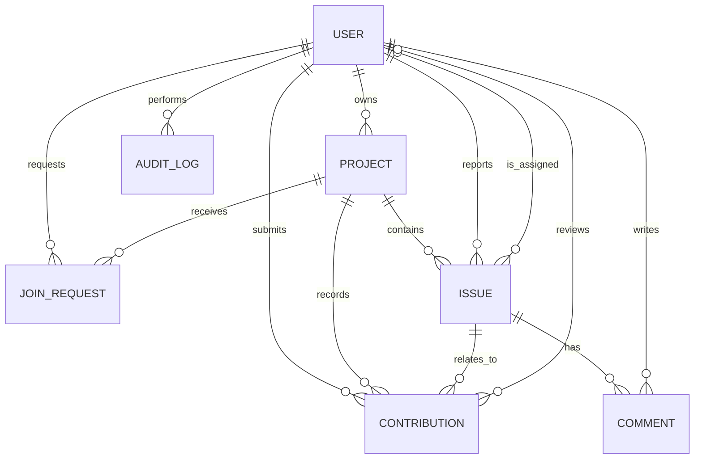

# Database Schema Design

## Scope and Decisions

MongoDB with Mongoose stores the campus tracker data. The six requested collections are created, plus `AuditLog` because the approved SRS requires traceable administrative and verification decisions. `Notification` is not created: the approved design defers notifications until after the MVP.

Project membership is represented by an approved `JoinRequest`, rather than a second `Membership` collection or a duplicated `Project.members` array. `Project.members` is a Mongoose virtual that populates approved join-request records; each request contains the referenced student. This gives membership one source of truth and lets MongoDB enforce uniqueness for pending requests and accepted memberships.

Mongoose's default collection names are lowercase plurals: `users`, `projects`, `issues`, `comments`, `contributions`, `joinrequests`, and `auditlogs`.

## ER-Style Relationships



## Relationships and Integrity

- **User to Project:** one user owns many projects; every project has one owner (`Project.owner`).
- **Project to User membership:** one project and one student can have multiple historical rejected/cancelled requests, but at most one pending request and one approved membership. Approved `JoinRequest` records are the membership relation. Requests from non-students, self-join requests by the owner, and new requests from existing members must be rejected by the service layer.
- **Project to Issue:** one project has many issues; each issue stores a required project reference.
- **Issue to User:** every issue has a reporter and may have an assignee. The API must ensure reporter/assignee authorization against the project's membership policy.
- **Issue to Comment:** each comment references one issue and one author. Comments are queried separately and are not embedded in issues.
- **Contribution:** each contribution references its contributor, project, and issue. The service layer must verify that the referenced issue belongs to the referenced project and the contributor may contribute there.
- **Contribution review:** submitted contributions have no reviewer. Verified contributions require `verifiedBy` and `verifiedAt`; rejected contributions retain `reviewedBy`, `reviewedAt`, and an optional decision note. Schema validation rejects self-verification; API authorization must also reject it.
- **AuditLog:** append-only application events reference the actor and target. Do not copy passwords, tokens, whole request bodies, or unrestricted user metadata into audit records.
- **Cross-document rules:** Mongoose references do not provide foreign-key constraints. Services must confirm referenced documents exist and are mutually consistent. If an approval changes multiple documents, use a MongoDB transaction on a replica set, or make the transition idempotent and recoverable.

## Schema Reference

All mutable domain schemas use Mongoose `timestamps: true` (`createdAt`, `updatedAt`) and disable the extra `__v` field. ObjectId references use the model names shown below.

| Model / collection | Fields and validation |
|---|---|
| `User` / `users` | `name` required, 2-80 chars; `email` required, trimmed/lowercase, format-checked and unique; `passwordHash` required, bcrypt-format checked and excluded from queries/serialization; `role` enum `student/admin`, default `student`; `accountStatus` enum `active/suspended`, default `active`; `bio` max 500; `skills` string array, max 30 unique case-insensitively; `profileImage` optional HTTP(S) URL. |
| `Project` / `projects` | `title` required, 3-120 chars; `description` required, 20-10,000 chars; `repositoryUrl` required HTTP(S) URL; `technologies` string array, max 30 unique case-insensitively; `owner` required User ref; `status` enum `pending/approved/rejected/archived`, default `pending`; `visibility` enum `public/private`, default `public`; optional moderation actor/time/note; `members` virtual returns approved `JoinRequest` records. |
| `Issue` / `issues` | `title` required, 3-200 chars; `description` required, 10-20,000 chars; `type` enum `bug/feature`; `priority` enum `low/medium/high/urgent`, default `medium`; `status` enum `open/triaged/in_progress/resolved/closed/rejected`, default `open`; required `project` and `reporter` refs; nullable `assignee` User ref. |
| `Comment` / `comments` | Required `issue` and `author` refs; `content` required, 1-10,000 chars. Timestamps support later edit/audit behavior. |
| `Contribution` / `contributions` | Required `user`, `project`, and `issue` refs; `contributionType` enum `bug_fix/feature/documentation/testing/design/other`; required `summary`, 10-2,000 chars; optional HTTP(S) `evidenceUrl`; `verificationStatus` enum `submitted/verified/rejected`, default `submitted`; verified state requires `verifiedBy` and `verifiedAt`; rejected state requires `reviewedBy` and `reviewedAt`; optional decision note. |
| `JoinRequest` / `joinrequests` | Required `project` and `student` refs; optional `message`, max 1,000; `status` enum `pending/approved/rejected/cancelled`, default `pending`; non-pending states require `decidedBy` and `decidedAt`; optional decision note. An approved record is a project membership. |
| `AuditLog` / `auditlogs` | Required `actor`, constrained `action`, `targetType`, and `targetId`; optional reason max 1,000; immutable creation timestamp only. This model is included to meet the approved SRS audit requirement. |

## Indexing Strategy

Mongoose declares these indexes. They are created by MongoDB when auto-indexing is enabled in development; production index creation should be an explicit, reviewed deployment operation.

| Collection | Index | Query/integrity purpose |
|---|---|---|
| `users` | Unique `{ email: 1 }` | Account lookup and duplicate email prevention. |
| `users` | `{ role: 1, createdAt: -1 }` | Admin user filtering by role and recent registration. |
| `projects` | `{ status: 1, visibility: 1, updatedAt: -1 }` | Approved project discovery and sorting. |
| `projects` | `{ owner: 1, status: 1, updatedAt: -1 }` | Owner project list. |
| `projects` | Text index on `title`, `description`, `technologies` | Basic project search. MongoDB allows one text index per collection. |
| `issues` | `{ project: 1, status: 1, updatedAt: -1 }` | Project issue tracker and status filter. |
| `issues` | `{ project: 1, type: 1, status: 1, createdAt: -1 }` | Project/type/status filtering. |
| `issues` | `{ assignee: 1, status: 1, updatedAt: -1 }` | Assigned issue dashboard. |
| `issues` | `{ reporter: 1, createdAt: -1 }` | Issues reported by a user. |
| `comments` | `{ issue: 1, createdAt: 1 }` | Chronological issue discussion. |
| `comments` | `{ author: 1, createdAt: -1 }` | User comment history/moderation lookup. |
| `contributions` | `{ user: 1, verificationStatus: 1, createdAt: -1 }` | User contribution history. |
| `contributions` | `{ project: 1, verificationStatus: 1, createdAt: -1 }` | Project contribution review queue. |
| `contributions` | `{ issue: 1, createdAt: -1 }` | Contributions for an issue. |
| `contributions` | Unique `{ issue: 1, user: 1 }`, partial `verificationStatus: submitted` | Prevent concurrent duplicate pending contributions for the same issue/user. |
| `joinrequests` | Unique `{ project: 1, student: 1 }`, partial `status: pending` | Prevent duplicate pending join requests under concurrent writes. |
| `joinrequests` | Unique `{ project: 1, student: 1 }`, partial `status: approved` | Prevent duplicate membership records under concurrent writes. |
| `joinrequests` | `{ project: 1, status: 1, createdAt: -1 }` | Owner request queue and member list. |
| `joinrequests` | `{ student: 1, status: 1, createdAt: -1 }` | Student's requests and memberships. |
| `auditlogs` | `{ targetType: 1, targetId: 1, createdAt: -1 }` | Target audit history. |
| `auditlogs` | `{ actor: 1, createdAt: -1 }` | Recent actions by an administrator. |

Unique indexes are database constraints, not Mongoose validators. Existing duplicates must be cleaned before index creation succeeds. The partial indexes prevent repeated pending/approved records, but the service must also reject a new pending request when an approved membership already exists.

## Validation and Connection Tests

Run model tests without a database:

```powershell
cd server
npm test
```

These tests verify required fields, enums, ObjectId refs, conditional verification fields, password selection, project membership virtual, and unique partial-index definitions. They do **not** prove that MongoDB created/enforces the indexes; that requires a live MongoDB instance.

Set `MONGODB_URI` in `server/.env` (copy from `.env.example`, then use a local or Atlas URI) and run `npm run dev`. The API logs a successful Mongoose connection when it connects. `GET /api/v1/health` reports `database.configured` and `database.connected`. In the current workspace there is no `.env`, MongoDB executable, or local listener on port 27017, so a successful live connection cannot be claimed until a URI and running database are provided.

## Deferred Collections

`Notification` is deferred because notification delivery is optional/post-MVP in the approved design. `Membership` is not a separate collection because approved `JoinRequest` records already represent membership. No files or unbounded arrays of comments/contributions are embedded in parent documents.