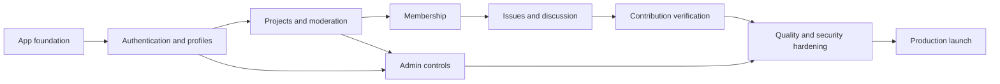

# Development Roadmap

## Planning Principles

- Build and verify one milestone at a time; do not begin the next milestone while the current exit criteria fail.
- Keep the first release to one campus, one Express deployment, and MongoDB Atlas. Avoid microservices, real-time infrastructure, and integrations until validated need exists.
- Estimate below assumes one developer working steadily and access to hosting/database accounts. Treat the schedule as a range; unfamiliarity with deployment, email verification, or campus policy can extend it.
- Essential scope is the MVP. Optional scope is explicitly deferred until the core workflow is deployed and used.

## Milestones

| Milestone | Indicative effort | Essential deliverable | Exit gate before proceeding |
|---|---:|---|---|
| 0. Requirements and setup | 2-3 days | Confirm campus policies, domain/email assumptions, privacy/retention decisions, repo layout, environment variable plan, and deployment target. | Stakeholder review of MVP scope and role/permission rules; clean local setup documented. |
| 1. App foundation | 3-5 days | Create Vite client and Express API skeleton, health endpoint, environment validation, MongoDB connection, central error handling, and initial CI/check scripts. | Client loads; API health check works; API connects to a non-production database; invalid configuration fails clearly; automated checks pass. |
| 2. Authentication and profiles | 1-1.5 weeks | Registration, login/logout, cookie-based JWT session, bcrypt, auth context, profile view/edit, protected API middleware. | Tests prove valid login, logout, duplicate-account handling, password hash non-disclosure, and authenticated/unauthenticated behavior. |
| 3. Projects and moderation | 1-1.5 weeks | Project submission/edit, pending approval, admin review, approved project discovery and detail view, basic search/filter. | A pending project is not discoverable; admin approval/rejection works; ownership and admin access boundaries pass API tests. |
| 4. Membership | 4-6 days | Join request, owner decision, member list, leave workflow, duplicate request protection. | Owner can decide only for owned project; unrelated users cannot view/manage request records; duplicate active request cannot be created. |
| 5. Issues and discussion | 1-1.5 weeks | Bug/feature issues, issue detail, owner triage/assignment/status, permitted comments, validation and pagination. | Member can create and discuss within policy; non-member/foreign-project access is denied correctly; invalid status transitions are rejected. |
| 6. Contributions and history | 4-6 days | Contribution submission, owner review, verified history, decision attribution and audit record. | Owner can verify another user's submission; self-verification and foreign-project decisions fail; history persists after re-authentication. |
| 7. Admin and quality hardening | 4-7 days | Basic user/content moderation, moderation audit view, accessibility and responsive pass, security checks, operational logging. | Permission matrix and high-risk API tests pass; keyboard/mobile smoke checks pass; production errors disclose no secrets or stack traces. |
| 8. Production launch | 3-5 days | Production frontend/API deployment, TLS, managed secrets, restricted database access, backups, restore instructions, monitoring and launch checklist. | End-to-end smoke test against production-like environment passes; backup restore is demonstrated; rollback/contact procedure is written. |

Estimated MVP: approximately 7-10 weeks for one developer, excluding stakeholder response delays and external account/hosting setup. The range is intentionally broad; quality, security, and policy decisions should not be cut to meet a date.

## Module Dependencies

The primary implementation order follows these dependencies:

Project approval precedes discovery; membership precedes member-only issue/contribution workflows; issue tracking precedes issue-linked contributions. Basic audit logging should be introduced alongside moderation and verification, not retrofitted after those actions exist.

## Essential MVP Scope

- Campus-student accounts, login/logout, editable profiles.
- Project submission, approval, management, and discovery.
- Membership requests and owner decisions.
- Bug reports and feature requests, assignment, status, and comments.
- Contribution submission, owner verification, and contributor history.
- Minimal admin moderation and audit trail.
- Responsive accessible experience, server-side authorization, persisted MongoDB data, automated tests, production deployment and backup/restore procedure.

## Optional Scope After MVP

Prioritize optional work only after measuring actual student usage and operational needs:

1. Campus email verification and password recovery.
2. Notifications and digest preferences.
3. GitHub OAuth, pull-request linking/sync, and webhooks.
4. Multiple campus support and campus-level administration.
5. Rich issue templates, labels, milestones, markdown, file attachments.
6. Analytics, exports, badges, reputation, or leaderboards.
7. Advanced moderation/reporting, appeals, and configurable retention tooling.
8. SSO, high-availability deployment, search service, or event queue if measured scale requires them.

AI functionality is not part of the initial MVP and should not be added without a separate product/security review.

## Per-Milestone Delivery Checklist

For each milestone:

- Confirm the user-facing behaviors and API authorization rules before coding.
- Implement the smallest cohesive slice; do not add later-phase modules opportunistically.
- Add unit/API/UI tests appropriate to the changed behavior, especially permission and persistence cases.
- Run relevant automated checks and a manual workflow test; record what was tested and any known gaps.
- Review configuration and data handling for secrets, personal data, and production-safe errors.
- Update this roadmap or the README only when scope, commands, or completion evidence changes.
- Mark a milestone complete only when its exit gate passes; otherwise fix or narrow the milestone before continuing.

## Release Readiness Checklist

- [ ] All essential MVP workflows pass end-to-end against a persistent database.
- [ ] API authorization is covered for student, owner, admin, and unauthenticated actors.
- [ ] No fake success responses or placeholder data paths remain in production workflows.
- [ ] Production secrets are configured in the hosting secret store and absent from source/build artifacts.
- [ ] HTTPS, cookie/CORS/CSRF configuration, request limits, and rate limiting are confirmed in the deployed topology.
- [ ] MongoDB production access is restricted; backup and restore have been tested.
- [ ] Privacy notice, moderation process, account handling, and incident contact are published/defined.
- [ ] Core pages work on mobile, keyboard navigation, and supported browsers.
- [ ] Basic logs and health checks are available without recording credentials or unnecessary personal data.
